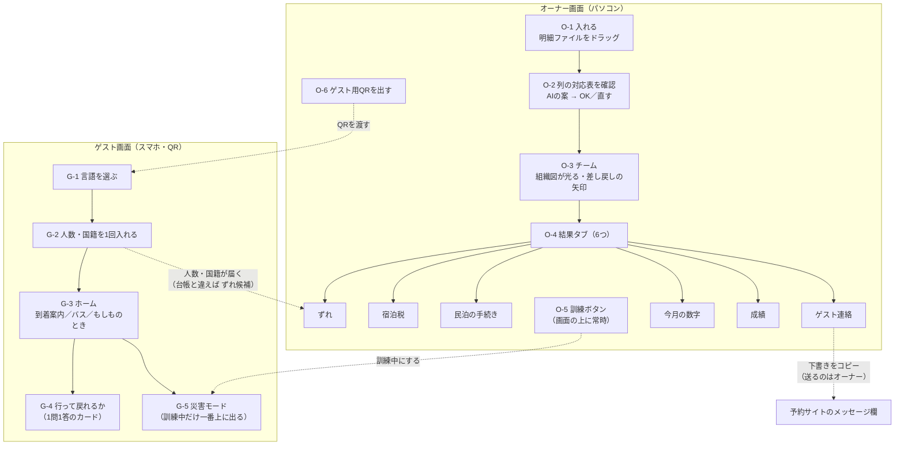
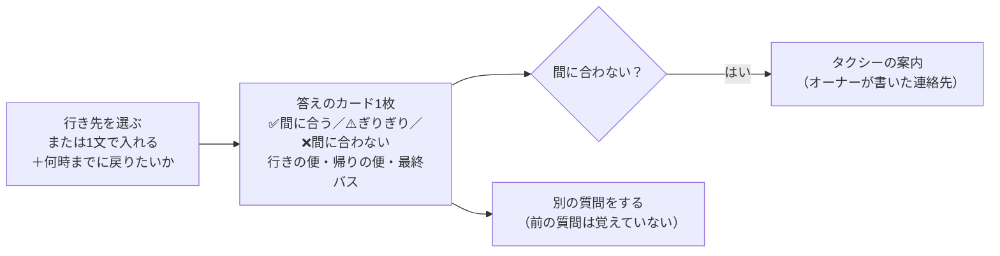

# ① 画面一覧と画面の流れ

AI番頭の画面は **2種類** です。

- **オーナー画面**：パソコンで使う。1ページを上から順に進む形
- **ゲスト画面**：スマホで使う。QRで開き、アプリは不要

- 根拠：仕様書 v1.3 §3（作る範囲）・§5-8・§6
- 関連：[② データ設計](02_データ設計.md)／[③ 処理の分担表](03_処理の分担表.md)
- 記号：💭 提案（未確定）／❓ 確認したいこと／🔒 守りの決まり
- 状態：下書き（2026-11-02・ケン/ゾロのレビュー反映）

> このリポジトリは公開されています。画面に出る名前・宿・予約はすべて架空です。

---

## 0. 全体の流れ

**大事な決まり**
- 🔒 **送信・提出のボタンはどこにも作りません。** あるのは「コピー」と「OK／直す」だけです。
- 🔒 **チャット欄は作りません。** オーナー画面は下書きの一覧、ゲスト画面は1問1答のカードです。
- 画面の一番下に、いつも次の3文を出します。
  - 「下書きです。確認と提出・送信はご本人が行います」
  - 「デモのデータはすべて架空です」
  - 「AIの処理は米国のAnthropic社で行います」

---

## 1. 画面の一覧

| ID | 画面 | どこ | 機能 | 優先 | 削る順 |
|---|---|---|---|---|---|
| O-1 | 入れる | オーナー | M1 | 必須 | 削らない |
| O-2 | 列の対応表を確認 | オーナー | M1 | 必須 | 削らない |
| O-3 | チーム（組織図） | オーナー | 全体 | 必須 | 5（光るだけにして履歴を省く） |
| O-4-1 | ずれ | オーナー | M2〜M4 | 必須 | 削らない |
| O-4-2 | 宿泊税 | オーナー | M5 | 必須 | 削らない |
| O-4-3 | 民泊の手続き | オーナー | M10・M11 | 必須 | 削らない |
| O-4-4 | ゲスト連絡 | オーナー | M6・M15（M7） | 必須（M7は余裕があれば） | 1（M7の返信を最初に削る） |
| O-4-5 | 今月の数字 | オーナー | M8 | 必須（動画には出さない） | 2（数字だけ出し、読み解きを省く） |
| O-4-6 | 成績 | オーナー | M9 | 必須 | 4（比べる組み合わせを減らす） |
| O-5 | 訓練ボタン | オーナー | M15 | 必須 | 削らない |
| O-6 | ゲスト用QRを出す | オーナー | M12 | 必須 | 削らない |
| G-1 | 言語を選ぶ | ゲスト | M12 | 必須 | 削らない |
| G-2 | 人数・国籍を入れる | ゲスト | M12 | 必須 | 6（台帳の数字で代用） |
| G-3 | ホーム（3つのタブ） | ゲスト | M6・M13・M15 | 必須 | 削らない |
| G-4 | 行って戻れるか | ゲスト | M14 | 必須 | 3（行き先ボタン3つ・決まった文にする） |
| G-5 | 災害モード | ゲスト | M15 | 必須 | 削らない |
| G-X | URLが使えません | ゲスト | 守り | 必須 | 削らない |

> 遅れたら「削る順」の小さい番号から削ります（仕様書 §3 の縮小表と合わせる）。番号は 💭 案です。

💭 宿の情報（チェックイン方法・ハウスルール・約束してよいことの一覧など）は、ハッカソンでは**最初から入れた架空データ**を使います。編集する画面は作りません。

---

## 2. オーナー画面

URLは `/`（1ページ）です。画面の上には、いつも「チーム」と「訓練ボタン」が出ています。

### O-1 入れる（M1）
| 項目 | 内容 |
|---|---|
| 目的 | 月末の明細をまとめて入れる |
| 表示 | ドラッグする枠と、入れるファイルの案内「Airbnbの明細・Bookingの明細・楽天の明細・予約台帳・通帳」。入れたファイルごとに、何のファイルと判断したかを表示 |
| 操作 | ファイルをドラッグする → 「読み込む」 |
| 決まり | 受け付けるのは **CSV だけ**（Excelは余裕があれば）。大きさの上限は 💭5MB・行数の上限あり。画像やPDFは断る |
| 次へ | O-2 |

### O-2 列の対応表を確認（M1）
| 項目 | 内容 |
|---|---|
| 目的 | 経理担当（AI）が作った「どの列が何か」の案を、人が確かめる |
| 表示 | ファイルの見出し行と、**伏せたサンプル2〜3行**。その横にAIの案（例：「3列目＝予約番号」「7列目＝手数料」）と自信の度合い |
| 操作 | 列ごとに選び直せる → 「この対応でOK」 |
| 決まり | 🔒 AIに見せたのは見出しと伏せた数行だけ、と画面に書く。OKを押すまでは全行を読み込まない |
| 次へ | O-3（突き合わせが始まる） |

> 💭 一度OKにした対応表は、同じ形式のファイルなら次回から自動で使います（確認済みの印を付ける）。デモでは1回だけ見せます。

### O-3 チーム（組織図）
| 項目 | 内容 |
|---|---|
| 目的 | 「AIの担当者チームが働いている」様子を見せる（審査の「Claude活用」） |
| 表示 | 番頭・経理担当・監査役・宿泊担当・経営企画の5つの箱。いま働いている担当が光る。**監査役の差し戻しは矢印と件数**で出す。担当を押すと、最近の仕事の履歴（何を受け取り何を返したか。個人情報は出さない） |
| 操作 | 担当の箱を押すと履歴が開く |
| 仕組み | 💭 1秒ごとに作業記録（`agent_runs` 表）を読みにいく |

### O-4 結果タブ（6つ）

#### O-4-1 ずれ（M2〜M4）
- **表示**
  - 自動で一致した件数（例：「40件中33件は自動で一致」）
  - 合わないものの一覧：理由の候補・根拠の数字・自信の度合い・監査役のコメント（差し戻しがあればその経緯）
  - ゲストが入れた人数が台帳と違う場合も、ここに出す
- **操作**：「OK」または「直す」（金額や人数を手で直す）
- 🔒 AIの理由は「候補」と書く。正しいかどうかを決めるのはオーナー

#### O-4-2 宿泊税（M5）
- **表示**：月ごとの人泊数・税額・計算の内訳（予約ごと・月をまたぐ連泊の分け方）・計算した税額と実際に預かった額の差
- **操作**：月を選ぶ／CSVで書き出す
- 🔒 「申告書」とは呼ばず「集計表」と呼ぶ。消費税の扱いは「税理士に確認」と書く

#### O-4-3 民泊の手続き（M10・M11）
- **表示**
  - 180日のメーター：使った日数／残り日数／このペースだと上限に届く月。残り30日と10日で警告
  - 定期報告の集計表：4項目（宿泊日数・宿泊者数・延べ宿泊者数・国籍別）、期限までの日数、数え方の内訳
- **操作**：期間を選ぶ。数字は**入力欄と同じ順番**で並べる
- 🔒 「民泊制度運営システムに入力してください」と案内するだけ。提出はしない。上限が近くても、予約を断る判断はしない

#### O-4-4 ゲスト連絡（M6・M15、M7は余裕があれば）
- **表示**：ゲストごとの下書きのカード
  - 相手の言語の文・日本語の対訳・**訳し戻し**
  - 伏せた箇所の色
  - 検査の結果（数字が合っているか・必ず入れる項目があるか）
  - 監査役のコメント
  - 種類の印：到着案内／避難の案内／返信
- **操作**：「OK」「直す」「コピー」
- 🔒 送信ボタンは作らない。「予約サイトのメッセージ欄に貼ってください」と案内する
- 🔒 暗証番号は、予約が確定したゲストの到着案内にだけプログラムが入れる。画面では「●●●●（コピー時に入ります）」と隠す 💭

#### O-4-5 今月の数字（M8）
- **表示**：予約サイト別の手取り・客室単価・稼働率・国籍の内訳。経営企画の読み解き（3〜5行）と「**今月やること3つ**」
- 「やること3つ」は O-4 のタブの上にも出す（結果を開いたら最初に目に入る場所）
- 数字は保存せず、開くたびにプログラムが計算する。AIの読み解きだけを保存し、数字が変わったら作り直す
- 宿泊税は売上に入れず、預り金として分けて表示
- 動画には出さないので、作る順番は最後

#### O-4-6 成績（M9）
- **表示**：例題40件の正答率
  - 分野別（経理・多言語・民泊・バス）
  - 比べた結果：Skillあり／なし、監査役あり／なし
  - 見逃しと、間違った指摘の件数
  - 差し戻しの履歴
- **操作**：見るだけ。例題は手元のパソコンのスクリプトで流し、結果だけを入れる（画面から流すボタンは作らない＝APIの使いすぎと悪用を防ぐ）
- 必ず「自作の例題40件での結果」と添える

### O-5 訓練ボタン（M15）
- **表示**：画面の上に「訓練：津波注意報」ボタン。訓練中は画面のまわりが赤くなり、「訓練中」「公式の警報・避難指示の代わりではありません」と出る
- **操作**：押すと訓練が始まる
  - ゲスト画面が G-5 に切り替わる
  - 泊まっているゲストごとに、その言語の避難の案内の下書きができる（O-4-4 に並ぶ）
- もう一度押すと訓練が終わる

### O-6 ゲスト用QRを出す（M12）
- **表示**：予約を選ぶと、そのゲスト専用のQRとURL、使える期限が出る
- 🔒 URLは推測されにくい長い文字列にする。期限は 💭チェックアウト日の正午まで
- 🔒 QRの画面をそのまま動画に映さない（架空でも）

---

## 3. ゲスト画面

URLは `/g/{ゲスト専用の文字列}` です。スマホ向けの縦長1ページで、アプリは要りません。

### G-1 言語を選ぶ
- 選べる言語：**한국어／繁體中文／English／日本語**
- 💭 スマホの言語設定から最初の候補を選んでおく
- 選んだ言語は覚えておく（このURLの中だけ）

### G-2 人数・国籍を入れる（1回だけ）
- **入力**：大人・子ども・乳幼児の人数、国籍（人数分。国名を一覧から選ぶ）
- 🔒 **名前・旅券番号・写真は求めない。**「宿泊税と、法律で決まった報告の人数を数えるためです」と理由を書く
- 入れた数字が台帳と違う場合、台帳は書き換えず、オーナー画面の「ずれ」に候補として出す
- 一度入れたら次からは出さない（直したいときは「人数を直す」から）

### G-3 ホーム（3つのタブ）
| タブ | 表示 | 機能 |
|---|---|---|
| **到着案内** | チェックイン方法・ハウスルール（夜は静かに・ごみ・火の扱い）・設備の使い方・宿泊税の説明・緊急連絡先（119/110）。必ず入れる項目は仕様書 §5-3 のとおり | M6 |

- **宿泊税の説明は、税の預かり方で文を変えます**（数字はプログラムが入れる）
  - 宿で預かる：「1人1泊200円 × ◯人 × ◯泊 ＝ ◯円」
  - 予約サイトが預かり済み：「宿泊税はお支払い済みです」
  - 分からない：金額を出さず「オーナーにご確認ください」
- **出す文の出どころ**：オーナーが「OK」にした到着案内の下書きだけを出します。OK前・下書きなしのときは、宿の決まった文（架空データ）を出します
| **バス** | 宿を真ん中にした路線図（線の太さ＝1日の本数）、宿から最寄りのバス停への歩く道・分数・写真、乗り方の絵、最寄りのバス停の「次のバス」と「**今日の最終バス**」、「行って戻れるか」への入口 | M13 |
| **もしものとき** | 津波の避難先2か所（直線距離・地図のリンク）・119/110・オーナーの連絡方法 | M6・M15 |

🔒 守りの決まり
- 宿の正確な住所・部屋番号・入口の暗証番号は、**期限内のURLで、予約が確定していて、チェックインの日から**だけ出します。💭 予約の前や期限切れのURLでは出しません。
- 開くたびに「期限・取り消し・予約が確定のままか・日付」を確かめます。予約が取り消し・変更されたら、そのURLは自動で使えなくなります（G-X）
- 「行って戻れるか」などAIの答えに、住所・暗証番号は入りません（入れてよい差し込みは到着案内の住所と暗証番号だけ、とプログラムで決めてある）
- バスのタブには、いつも次の3つを出します。
  - 「デモ用・◯年◯月時点の時刻表から作成。必ず公式の時刻表で確認してください」
  - バス案内センターの番号
  - 「宮交バスどこドコ？？」へのリンク
- 地図の下に出典「国土地理院」を表示します。

### G-4 行って戻れるか（M14・1問1答のカード）

- **表示**
  - 行き先の一覧（例：鵜戸神宮・青島神社・宮崎駅）と、自由に1文を入れる欄
  - 答えは**カード1枚**。時刻はプログラムが時刻表から入れ、AIは説明の文だけを書く
- 🔒 会話の履歴は持たない
- 🔒 一覧にない行き先や分からない質問には「分かりません。オーナーに聞いてください」と返す
- 🔒 体調・事故・道に迷ったときは、AIは答えず 119／オーナーへ回す
- 🔒 💭 1つのURLにつき、AIを呼べるのは1日10回まで（APIの使いすぎを防ぐ）。入れられる文は200文字まで
- 🔒 回数は同時に押されてもずれない数え方にする。さらに**アプリ全体の1日の上限**を設け、超えたら決まった文だけを返す
- **削るとき**（11/7 12:00に間に合わない場合）：自由な1文の欄をやめ、行き先ボタン3つにする。説明は決まった文にする

### G-5 災害モード（M15・訓練中だけ）
- ホームの一番上に赤い帯が出て、「**訓練：津波注意報**」と避難の案内が表示される
- バスのタブの地図が、バス路線から**避難先**に切り替わる
- 固定の文を出す（プログラムが付ける）
  - 「バスを待たずに高い場所へ」
  - 「津波警報が出たら戻らない」
  - 「最新の情報は宮崎市のハザードマップで確認してください」
- 出典「国土地理院 指定緊急避難場所データ（◯年◯月時点）」
- 🔒 いつも「訓練」「公式の警報・避難指示の代わりではありません」を出す
- 仕組み：💭 ゲスト画面は5秒ごとに「訓練中か」を確かめる

### G-X URLが使えません
- 期限切れ・取り消し済み・間違ったURLのときに出す
- 「このページは使えません。宿のオーナーにお問い合わせください」（4言語）
- 宿の名前・住所は出さない

---

## 4. 動画（3分）で映す画面の順番
仕様書 §10 との対応です。

| 時間 | 画面 |
|---|---|
| 0:25–1:00 | G-1 → G-3（到着案内）→ G-3（バス）→ G-4 |
| 1:00–1:15 | O-4-1（ゲストが入れた人数）→ O-4-2 → O-4-3 |
| 1:15–1:40 | O-3（組織図・差し戻しの矢印）→ O-4-1 |
| 1:40–2:10 | O-5 → G-5 → O-4-4（避難の案内の下書き・訳し戻し） |
| 2:10–2:22 | O-4-6 |

**作る順番の目安**
O-1 → O-2 → O-4-1 → O-4-2 → O-4-3 → O-3 → O-4-4（到着案内の下書き＝M6） → G-1〜G-3 → G-4 → O-5・G-5 → O-4-6 → O-4-5

※ G-3 の到着案内は「OKにした下書き」を出すので、M6（O-4-4）を先に作ります。

---

## 5. 決めたいこと
- ✅（レビューで決定・社長の確認待ち）**オーナー画面の入口の鍵**：鍵は必須。本番のオーナー画面は Cloudflare Access（メールで入る）。審査員に触ってもらう場合は、**別のデモ用の環境**（架空データ・毎晩リセット・AIは1日約100回まで・例題は流せない）を用意する。動画だけで見せるなら、デモ用の公開は不要（詳しくは ② の §5）
- ❓ 宿のURLの期限：「チェックアウト日の正午まで」でよいか
- ❓ 住所と暗証番号を出し始める時刻：「チェックインの日の0時から」でよいか
- ❓ 「行って戻れるか」の回数の上限：1日10回でよいか
- 💭 仕様書 §6 の題名「画面（1枚）」を「画面（オーナー画面＋ゲスト画面）」に直し、詳しくはこの資料へリンクする
