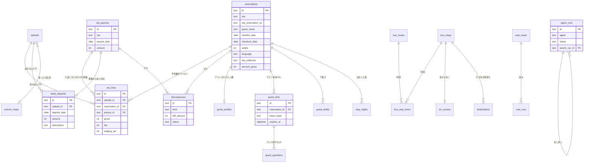

# ② データ設計（ER図＋テーブル定義）

AI番頭が覚えておくデータの一覧です。置き場所は次の3つです。

- **D1**（データベース）：表になるデータ
- **R2**（ファイル置き場）：写真だけ
- **Workers Secrets**（金庫）：鍵と暗証番号だけ

- 根拠：仕様書 v1.3 §5-6（AIに渡してよい情報）・§7-1・§7-2
- 関連：[① 画面一覧](01_画面一覧.md)／[③ 処理の分担表](03_処理の分担表.md)
- 記号：💭 提案（未確定）／❓ 確認したいこと
- 状態：下書き（2026-11-02・ケン/ゾロのレビュー反映）

> このリポジトリは公開されています。ここに書くのは**表の形だけ**です。入れるデータはすべて架空で、実在のお客様・宿泊者・宿のデータは入れません。

---

## 0. 列に付ける印

| 印 | 意味 |
|---|---|
| 🚫 | **AIに送らない**。プログラムの中だけで使う |
| 🎭 | **伏せてから**AIに送ってよい（名前は GUEST_1、番号は ●●） |
| ✅ | そのままAIに送ってよい（数字・言語・日付など） |
| 👤 | 個人情報。表示はオーナー画面だけ。書き出しやログに出さない |
| 🔑 | D1に入れず **Secrets** に置く |
| 🖼 | ファイルは **R2**。D1には置き場所の名前だけ |

印のない列は、プログラムの管理用です（番号・作った日時など）。AIには送りません。

**ことばの説明**
| ことば | 意味 |
|---|---|
| PK（主キー） | その表の中で1行を見分ける番号。同じ値の行は2つ作れない |
| FK（つなぎの列） | ほかの表の行を指す番号。例：明細の `reservation_id` は、どの予約の明細かを指す |
| JSON | 1つの欄に「名前：値」のまとまりを入れる書き方。例：`{"TW":2}`＝台湾2人 |
| 指紋（ハッシュ） | 元の文字から作る短い記号。指紋から元の文字には戻せない。同じかどうかの見分けにだけ使う |

---

## 1. ER図（表どうしのつながり）

※ 図には主な列だけを載せています。全部の列は次の表定義にあります。

---

## 2. テーブル定義

### 2-1. お金（M1〜M5）

#### `uploads` 読み込んだファイル
| 列 | 型 | 内容 | 印 |
|---|---|---|---|
| id | TEXT PK | ファイルごとの番号 | |
| kind | TEXT | airbnb／booking／rakuten／ledger（台帳）／bank（通帳） | ✅ |
| filename | TEXT | ファイル名 | 🚫 |
| header_hash | TEXT | 見出し行の指紋（同じ形式か見分ける） | |
| column_map_id | TEXT FK | 使った列の対応表 | |
| map_confirmed | INTEGER | オーナーがOKを押したか（0/1） | |
| row_count | INTEGER | 行の数 | |
| uploaded_at | TEXT | 読み込んだ日時 | |

> 元のファイルは**保存しません**。読んだ行を下の表に入れたら捨てます（R2にも置きません）。

#### `column_maps` 列の対応表（使い回す）
| 列 | 型 | 内容 | 印 |
|---|---|---|---|
| id | TEXT PK | | |
| kind | TEXT | どの種類のファイル用か | ✅ |
| header_hash | TEXT | 見出し行の指紋 | |
| mapping_json | TEXT | 「3列目＝予約番号」などの対応 | ✅ |
| proposed_by | TEXT | ai／owner | |
| confirmed_at | TEXT | オーナーがOKにした日時 | |

#### `reservations` 予約台帳
| 列 | 型 | 内容 | 印 |
|---|---|---|---|
| id | TEXT PK | | |
| ota | TEXT | airbnb／booking／rakuten／direct | ✅ |
| ota_reservation_no | TEXT | 予約サイトの予約番号 | ✅（M3で使う） |
| guest_name | TEXT | 予約者の名前 | 🚫👤 |
| checkin_date / checkout_date | TEXT | 到着日・出発日 | ✅ |
| nights | INTEGER | 泊数（プログラムが計算） | ✅ |
| adults / children / infants | INTEGER | 台帳上の人数 | ✅ |
| language | TEXT | ko／zh-Hant／en／ja（／zh-Hans） | ✅ |
| tax_collection | TEXT | 宿泊税の預かり方：ota（予約サイトが預かる）／included（料金に込み）／onsite（現地で預かる）／unknown | ✅ |
| lodging_tax_collected | INTEGER | 実際に預かった宿泊税（円。分からなければ空） | ✅ |
| nationalities_json | TEXT | 台帳上の国籍ごとの人数（ゲストが入れていないときの予備。ゲストが入れた国籍があればそちらを使う） | ✅（集計した数だけ） |
| amount_gross | INTEGER | 予約の合計金額（円） | ✅ |
| room | TEXT | 部屋（A／B） | 🚫 |
| status | TEXT | confirmed／cancelled | ✅ |

> 予約の日付・人数・状態が変わったら、その予約のゲスト専用URLは**自動で取り消し**ます（③ M12）。

#### `ota_lines` 予約サイトの明細
| 列 | 型 | 内容 | 印 |
|---|---|---|---|
| id | TEXT PK | | |
| upload_id | TEXT FK | どのファイルから来たか | |
| ota | TEXT | 予約サイト | ✅ |
| ota_reservation_no | TEXT | 予約番号 | ✅ |
| reservation_id | TEXT FK | 突き合わせた結果つながった予約（なければ空） | |
| payout_id | TEXT FK | どの入金にまとめられたか | |
| line_date | TEXT | 明細の日付 | ✅ |
| line_type | TEXT | reservation（予約）／refund（返金）／fee（手数料）／adjustment（調整） | ✅ |
| payment_channel | TEXT | 予約サイトが集めて振り込む／宿が直接受け取る（Bookingの現地払いなど） | ✅ |
| gross / fee / lodging_tax / net | INTEGER | 売上・手数料・宿泊税・手取り（円）。返金はマイナス | ✅ |
| guest_name_raw | TEXT | 明細に載っている名前 | 🚫👤 |

#### `ota_payouts` 予約サイトからの入金（まとめ払い）
明細の中の「入金」の行（Airbnbの Payout 行など）から作ります。入金の行がない予約サイトは、同じ入金番号・同じ入金日の明細をまとめて作ります。
| 列 | 型 | 内容 | 印 |
|---|---|---|---|
| id | TEXT PK | | |
| ota | TEXT | | ✅ |
| payout_date | TEXT | 入金予定日 | ✅ |
| amount | INTEGER | 入金額 | ✅ |
| payout_ref | TEXT | 予約サイト側の入金番号 | ✅ |

#### `bank_deposits` 通帳の入金
| 列 | 型 | 内容 | 印 |
|---|---|---|---|
| id | TEXT PK | | |
| upload_id | TEXT FK | | |
| deposit_date | TEXT | 入金日・出金日 | ✅ |
| amount | INTEGER | 金額。**入金は＋、出金は−**（Bookingの月の手数料の引き落としなど） | ✅ |
| description | TEXT | 摘要（振込名義） | 🎭（個人名が入ることがある） |
| payout_id | TEXT FK | 対応した予約サイトの入金（なければ空） | |

> 口座番号は**読み込みません**。通帳の明細を読む段階で捨てます。出金（−）の行は入金の突き合わせに使いません。

#### `discrepancies` ずれ
| 列 | 型 | 内容 | 印 |
|---|---|---|---|
| id | TEXT PK | | |
| kind | TEXT | ledger_vs_ota（台帳と明細）／payout_vs_bank（入金と通帳）／tax_collected（計算した宿泊税と預かった額）／guest_count（ゲストが入れた人数と台帳） | ✅ |
| reservation_id / payout_id / deposit_id | TEXT FK | 関係する行 | |
| expected / actual / diff_amount | INTEGER | あるべき額・実際の額・差（プログラムが計算） | ✅ |
| reason_candidates_json | TEXT | 経理担当（AI）の理由の候補と根拠 | |
| confidence | TEXT | high／mid／low | |
| audit_json | TEXT | 監査役のコメント・差し戻しの回数 | |
| status | TEXT | open（未確認）／ok（オーナーがOK）／fixed（オーナーが直した） | |
| owner_note | TEXT | オーナーのメモ | 🚫 |
| resolved_at | TEXT | | |

> `guest_count` のずれをオーナーがOKすると、台帳（`reservations`）の人数を直し、宿泊税と定期報告を計算し直します。ゲストが入れた人数が**オーナーの確認なしに税へ入ることはありません**。

#### `tax_drafts` 宿泊税の集計表
| 列 | 型 | 内容 | 印 |
|---|---|---|---|
| id | TEXT PK | | |
| month | TEXT | 2026-08 など | ✅ |
| person_nights | INTEGER | 人泊数（**泊まった人は全員**。乳幼児を数えるかは `inn_profile.infants_taxable` に従う） | ✅ |
| tax_amount | INTEGER | 人泊数 × 200円 | ✅ |
| collected_amount | INTEGER | 実際に預かった額 | ✅ |
| diff | INTEGER | 差 | ✅ |
| breakdown_json | TEXT | 予約ごとの内訳・月をまたぐ連泊の分け方 | ✅（名前は入れない） |
| created_at | TEXT | | |

> 宿泊税は**売上に入れず、預り金**として扱います（仕様書 §4）。

### 2-2. ゲスト（M6・M7・M12・M14）

#### `guest_links` ゲスト専用URL
| 列 | 型 | 内容 | 印 |
|---|---|---|---|
| id | TEXT PK | | |
| reservation_id | TEXT FK | | |
| token_hash | TEXT | URLの文字列の**指紋だけ**を保存（文字列そのものは保存しない） | 🚫 |
| expires_at | TEXT | 使える期限（💭 出発日の正午） | |
| revoked | INTEGER | 取り消したか（0/1） | |
| ai_calls_today | INTEGER | 今日AIを呼んだ回数（💭 上限10回。「10回未満なら1増やす」を1つの命令で行う） | |
| ai_calls_date | TEXT | 回数を数えている日 | |
| created_at | TEXT | | |

> URLの文字列は、QRを出すときに1回だけ画面に出します。もう一度出したいときは新しく作り直し、古いURLは取り消します 💭。
> URLを開くたびに、期限・取り消し・**予約が確定のままか**・日付がいまの予約どおりかを確かめます。ログには指紋だけを残します。

#### `guest_profiles` ゲストが入れた人数・国籍
| 列 | 型 | 内容 | 印 |
|---|---|---|---|
| reservation_id | TEXT PK FK | | |
| language | TEXT | 選んだ言語 | ✅ |
| adults / children / infants | INTEGER | 人数 | ✅ |
| nationalities_json | TEXT | 国籍ごとの人数（例：{"TW":2}） | ✅（集計した数だけ） |
| submitted_at | TEXT | | |

> **名前・旅券番号・写真は持ちません。**

#### `guest_drafts` ゲストあての下書き（到着案内・避難の案内・返信）
仕様書 §7-1 の `arrival_guides` を、避難の案内と返信もまとめて入れられるようにした表です。

| 列 | 型 | 内容 | 印 |
|---|---|---|---|
| id | TEXT PK | | |
| reservation_id | TEXT FK | | |
| kind | TEXT | arrival（到着案内）／evacuation（避難の案内）／reply（返信） | ✅ |
| language | TEXT | | ✅ |
| draft_template | TEXT | AIが書いた文。**{DOOR_CODE} などの差し込み記号が入ったまま**保存する | |
| ja_text | TEXT | 日本語の対訳 | |
| back_translation | TEXT | 訳し戻し（別のAI呼び出しで作る） | |
| checks_json | TEXT | プログラムの検査結果（数字が合うか・必ず入れる項目があるか） | |
| audit_json | TEXT | 監査役のコメント | |
| status | TEXT | draft／ok／copied | |
| source_message_id | TEXT FK | 返信のとき、元のメッセージ | |
| created_at | TEXT | | |

> ゲスト画面の到着案内に出すのは、kind=arrival で status が ok（オーナーがOK）以降の下書きだけです。まだなければ `inn_profile` の決まった文を出します。
>
> 🔒 差し込み記号は機能ごとに許可リストで決めます。`{DOOR_CODE}` `{ADDRESS}` は kind=arrival のときだけ使えます。許可外の記号が入った文は捨てます。
>
> 🔒 **暗証番号は、この表にもどの表にも入れません。** プログラムが Secrets から取り出すのは次の2つの場面だけです。
> - オーナーが「コピー」を押した瞬間
> - ゲスト画面を、期限内のURLでチェックインの日から開いたとき

#### `guest_messages` ゲストから来たメッセージ（M7・余裕があれば）
| 列 | 型 | 内容 | 印 |
|---|---|---|---|
| id | TEXT PK | | |
| reservation_id | TEXT FK | | |
| language | TEXT | | ✅ |
| masked_text | TEXT | 名前・電話・メールを伏せた本文。オーナーが貼り付けたもの | 🎭 |
| received_at | TEXT | | |

> 伏せる前の文は保存しません。

#### `guest_questions` 行って戻れるか（M14）
| 列 | 型 | 内容 | 印 |
|---|---|---|---|
| id | TEXT PK | | |
| guest_link_id | TEXT FK | | |
| question_masked | TEXT | 伏せた質問（200文字まで） | 🎭 |
| parsed_json | TEXT | AIが読み取った {行き先, 戻りたい時刻, 曜日} | ✅ |
| judgment | TEXT | ok（間に合う）／tight（ぎりぎり）／ng（間に合わない）／unknown | ✅ |
| plan_json | TEXT | プログラムが選んだ行きの便・帰りの便・最終バス | |
| answer_template | TEXT | AIが書いた説明（差し込み記号入り） | |
| answer_lang | TEXT | | ✅ |
| created_at | TEXT | | |

> 💭 30日たったら消します。前の質問はAIに渡しません（1問1答）。

### 2-3. 宿（全体で使う）

#### `inn_profile` 宿の情報（1行だけ）
| 列 | 型 | 内容 | 印 |
|---|---|---|---|
| id | INTEGER PK | 1だけ | |
| name | TEXT | 宿の名前（デモ：架空の「しおさいの家」） | ✅ |
| type | TEXT | 家主居住型／家主不在型 | ✅ |
| rooms | INTEGER | 部屋数 | ✅ |
| address | TEXT | 正確な住所 | 🚫（ゲストには期限内のURLでだけ見せる） |
| lat / lng | REAL | 地図の中心 | 🚫 |
| checkin_method_json | TEXT | チェックイン方法（言語ごと）。暗証番号は {DOOR_CODE} と書く | ✅ |
| house_rules_json | TEXT | ハウスルール | ✅ |
| allowed_promises_json | TEXT | 約束してよいことの一覧（返信の下書きがこれ以外を約束したら監査役が止める） | ✅ |
| taxi_info_json | TEXT | タクシー会社の名前・電話 | 🚫（プログラムが差し込む） |
| owner_contact_json | TEXT | オーナーへの連絡方法 | 🚫（プログラムが差し込む） |
| fixed_arrival_json | TEXT | 決まった到着案内（言語ごと。下書きがまだないときにゲスト画面に出す） | ✅ |
| infants_taxable | INTEGER | 宿泊税で乳幼児を数えるか（1＝数える・既定）。免除がない限り1人と数える | ✅ |
| fiscal_year_start | TEXT | 180日を数え始める日（04-01） | |

#### `monthly_kpis` 今月の数字（M8）
数字（予約サイト別の手取り・客室単価・稼働率・国籍の内訳）は**保存せず、開くたびに計算**します（元の表と食い違わないため）。保存するのはAIが書いた文だけです。

| 列 | 型 | 内容 | 印 |
|---|---|---|---|
| month | TEXT PK | | ✅ |
| commentary | TEXT | 経営企画（AI）の読み解き（3〜5行） | |
| todo_json | TEXT | 番頭（AI）の「今月やること3つ」。オーナー画面のいちばん上に出す | |
| numbers_hash | TEXT | 読み解きを書いたときの数字の指紋（数字が変わったら書き直しの印を出す） | |
| created_at | TEXT | | |

### 2-4. 民泊の手続き（M10・M11）

#### `stay_nights` 泊まった夜（180日・定期報告を数える元）
予約1件 × 1泊ごとに1行です。

| 列 | 型 | 内容 | 印 |
|---|---|---|---|
| reservation_id | TEXT PK FK | （`night` と組で主キー） | |
| night | TEXT PK | 「正午から翌日の正午まで」を1日とした日付 | ✅ |
| fiscal_year | TEXT | 4月1日正午から始まる年度（例：2026） | ✅ |
| guests | INTEGER | その夜のその予約の宿泊者数 | ✅ |

> 180日は「**日付の種類の数**」で数えます。2部屋に別々の予約が入っていても、同じ日は**1日**です。宿泊者数・延べ宿泊者数は、予約ごとの行を足して出します（1日1行にすると2部屋目の人数が消えるため）。
> 予約が取り消されたら、その予約の行を消して数え直します。

#### `minpaku_reports` 定期報告の集計表
| 列 | 型 | 内容 | 印 |
|---|---|---|---|
| period | TEXT PK | 2026-08_09 など（偶数月の15日に出す分） | ✅ |
| due_date | TEXT | 期限 | ✅ |
| stay_days | INTEGER | 宿泊日数（`stay_nights` の日付の種類の数） | ✅ |
| guests | INTEGER | 宿泊者数 | ✅ |
| guest_nights | INTEGER | 延べ宿泊者数 | ✅ |
| nationality_json | TEXT | 国籍別の宿泊者数（ゲストが入れた国籍。なければ台帳の国籍） | ✅ |
| breakdown_json | TEXT | 数え方の内訳 | ✅ |
| created_at | TEXT | | |

> 0日の期間も、0のまま行を作ります（0日でも報告は必要なため）。

### 2-5. 災害（M15）

#### `shelters` 津波の避難先
| 列 | 型 | 内容 | 印 |
|---|---|---|---|
| id | TEXT PK | | |
| name | TEXT | 施設の名前（公開データ） | 🚫（AIには {SHELTER_1} で渡す） |
| lat / lng | REAL | 位置 | 🚫 |
| hazard | TEXT | tsunami だけ | |
| source / source_date | TEXT | 「国土地理院 指定緊急避難場所データ」・取得した日 | |

> 宿からの直線距離はプログラムが計算し、{SHELTER_1_DIST} に差し込みます。

#### `drill_state` 訓練中かどうか（1行だけ）
| 列 | 型 | 内容 | 印 |
|---|---|---|---|
| id | INTEGER PK | 1だけ | |
| active | INTEGER | 訓練中か（0/1） | |
| scenario | TEXT | tsunami_advisory（津波注意報） | |
| started_at / ended_at | TEXT | | |

### 2-6. バスと地図（M13・M14）

#### `bus_routes` 路線
| 列 | 型 | 内容 | 印 |
|---|---|---|---|
| id | TEXT PK | | |
| name | TEXT | 路線名 | ✅ |
| operator | TEXT | 宮崎交通 | ✅ |
| color | TEXT | 地図に描く色 | |
| trips_per_day_weekday / trips_per_day_holiday | INTEGER | 1日の本数（線の太さに使う） | |

#### `bus_stops` バス停
| 列 | 型 | 内容 | 印 |
|---|---|---|---|
| id | TEXT PK | | |
| name_ja / name_en / name_ko / name_zh_hant | TEXT | バス停の名前（言語ごと。中国語は繁体字） | ✅ |
| lat / lng | REAL | | 🚫 |
| photo_key | TEXT | 写真の置き場所 | 🖼 |

#### `bus_stop_times` 時刻表
| 列 | 型 | 内容 | 印 |
|---|---|---|---|
| id | INTEGER PK | | |
| route_id | TEXT FK | | |
| trip_id | TEXT | 便の番号 | |
| direction | TEXT | up（上り）／down（下り） | |
| stop_id | TEXT FK | | |
| seq | INTEGER | その便で何番目のバス停か | |
| time | TEXT | 発車時刻（HH:MM） | 🚫（AIに渡さない。プログラムが差し込む） |
| day_type | TEXT | weekday／holiday（土日祝） | |
| timetable_date | TEXT | いつ時点の時刻表か（画面に出す） | |

> 時刻表は、実在の路線を見て手で入れたものです。画面には必ず「デモ用・◯年◯月時点」と出します。
> 祝日は、その年の祝日の一覧をプログラムに持たせて holiday として扱います。

#### `inn_access` 宿から最寄りのバス停まで
| 列 | 型 | 内容 | 印 |
|---|---|---|---|
| stop_id | TEXT PK FK | | |
| walk_minutes | INTEGER | 歩く分数 | ✅ |
| walk_path_geojson | TEXT | 歩く道（地図に描く線） | 🚫 |
| photo_key | TEXT | 目印の写真 | 🖼 |
| note_json | TEXT | 一言の案内（言語ごと） | ✅ |

#### `destinations` 行き先の一覧
| 列 | 型 | 内容 | 印 |
|---|---|---|---|
| id | TEXT PK | | |
| name_ja / name_en / name_ko / name_zh_hant | TEXT | 行き先の名前（例：鵜戸神宮・青島神社・宮崎駅） | ✅（**名前だけ**AIに渡す） |
| stop_id | TEXT FK | 最寄りのバス停 | |
| walk_minutes_from_stop | INTEGER | バス停から歩く分数 | |

### 2-7. 成績・チーム（M9・組織図）

#### `eval_cases` 例題
| 列 | 型 | 内容 | 印 |
|---|---|---|---|
| id | TEXT PK | | |
| domain | TEXT | keiri（経理20）／tagengo（多言語10）／minpaku（民泊5）／bus（バス5） | |
| input_json | TEXT | 問題（架空のデータ） | ✅ |
| expected_json | TEXT | 正解 | 🚫（AIに見せない） |
| note | TEXT | 何を確かめる問題か | |

#### `eval_runs` 採点の結果
例題は**手元のスクリプトで流し**、結果だけをこの表に入れます。公開した画面からは流せません（費用と悪用を防ぐため）。

| 列 | 型 | 内容 | 印 |
|---|---|---|---|
| id | TEXT PK | | |
| case_id | TEXT FK | | |
| batch_id | TEXT | 1回の「例題を流す」の番号 | |
| variant | TEXT | full／no_skill／no_audit（比べるための条件） | |
| model | TEXT | 使ったモデル | |
| output_json | TEXT | AIの答え | |
| correct | INTEGER | 正解か（0/1） | |
| missed / false_alarm | INTEGER | 見逃し・間違った指摘 | |
| run_at | TEXT | | |

#### `agent_runs` 担当者の作業記録（組織図を光らせる元）
| 列 | 型 | 内容 | 印 |
|---|---|---|---|
| id | TEXT PK | | |
| agent | TEXT | banto（番頭）／keiri（経理担当）／kansa（監査役）／shukuhaku（宿泊担当）／keiei（経営企画） | |
| task | TEXT | 仕事の種類（column_map／reason／audit／translate など） | |
| status | TEXT | working／done／sent_back（差し戻された）／failed | |
| parent_run_id | TEXT FK | 差し戻しのとき、元の作業 | |
| sent_back_reason | TEXT | 監査役が差し戻した理由 | |
| input_summary / output_summary | TEXT | 何を受け取り何を返したかの要約（**個人情報は入れない**） | |
| model | TEXT | 使ったモデル | |
| tokens_in / tokens_out | INTEGER | 使った量（費用の確認用） | |
| created_at / finished_at | TEXT | | |

> AIに送った文そのもの・ゲストの質問の本文は保存しません（要約だけ）。要約は**差し込む前の文**から作るので、暗証番号や住所は入りません。

---

## 3. D1以外の置き場所

### Workers Secrets（金庫）🔑
| 名前 | 中身 | 使う場面 |
|---|---|---|
| `ANTHROPIC_API_KEY` | **当社名義**のAnthropic APIの鍵 | AIを呼ぶとき |
| `DOOR_CODE` | 入口の暗証番号（デモは架空の番号） | 到着案内の「コピー」を押したとき／ゲスト画面（期限内・チェックインの日から） |
| `ACCESS_AUD` など | Cloudflare Access の証明書（JWT）を確かめるための値 | オーナー画面の窓口を呼ぶたび |

- 手元で試すときは `.dev.vars`（Gitに入らない）を使います。見本は `.dev.vars.example`（中身は空）です。
- 将来、利用者が複数になったら、宿ごとの暗証番号は**暗号化してD1に保存**し、暗号の鍵だけを Secrets に置きます（全社ルール）。

### R2（ファイル置き場）🖼
- 入れるのは**写真だけ**です：バス停の写真、宿から歩く道の目印の写真。位置情報（EXIF）は消してから入れます。
- 公開URLは**オフ**にします。写真はプログラムを通して表示します。
- 明細ファイル・通帳・ゲストの写真は**入れません**。

---

## 4. AIに渡す情報のまとめ（§5-6 との対応）

| 機能 | AIに渡す | 渡さない |
|---|---|---|
| M1 列の対応 | 見出し行・**値の形で**伏せたサンプル2〜3行（文字→＜文字4字＞、番号→＜数字10桁＞） | 残りの全行・名前・口座番号 |
| M3 ずれの理由 | 予約番号・金額・日付・予約サイト名・プログラムが計算した差 | 名前・摘要の生の文 |
| M4 監査 | M3の答え・プログラムの検査結果 | 同上 |
| M6 到着案内 | 言語・人数・泊数・日付・宿泊税の預かり方・ハウスルール | 名前・暗証番号・住所・旅券 |
| M7 返信 | 伏せた本文・約束してよいことの一覧 | 伏せる前の本文 |
| M8 今月の数字 | 集計した数字だけ | 予約1件ごとのデータ |
| M14 行って戻れるか | 伏せた質問・行き先の**名前の一覧**・プログラムの判定と差し込み記号 | 時刻表そのもの・正確な住所 |
| M15 避難の案内 | 決まった文・言語・差し込み記号 | 名前・部屋番号・避難先の名前 |

---

## 5. 決めたいこと
- ✅（レビューで決定・社長の確認待ち）**オーナー画面の入口の鍵は必須**。本番のオーナー画面は **Cloudflare Access**（メールで入る）。
  - 審査員に触ってもらうなら、**別のデモ用Worker＋別のD1**を用意する（架空データ・毎晩リセット・アプリ全体で1日100回程度の上限・例題の実行はオフ）。本番のデータには触れない。
  - 動画だけで見せるなら、デモ用の公開は要りません。
- ❓ `guest_questions` を30日で消す、でよいか
- 💭 仕様書 §7-1 の `arrival_guides` は、この資料では `guest_drafts`（避難の案内・返信も入る）に名前を変えています。仕様書の側も直します。
