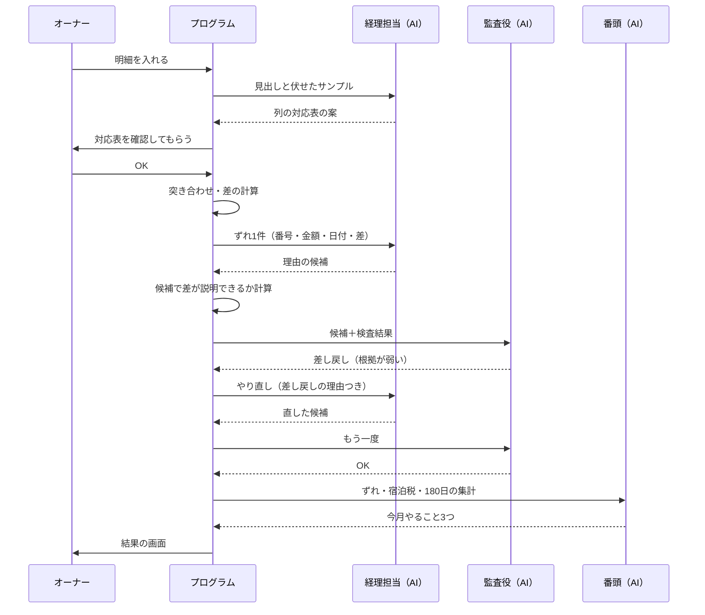

# ③ AIとプログラムの処理の分担表

AI番頭の芯は、次の分担です。

> **AIは考える・書く。プログラムは数える・確かめる。**

この資料では、機能ごとに次の4点を決めます。
- 何を受け取り、何を返すか
- AIとプログラムのどちらがやるか
- 誰が確かめるか

- 根拠：仕様書 v1.3 §2・§3・§5・§5-6
- 関連：[① 画面一覧](01_画面一覧.md)／[② データ設計](02_データ設計.md)
- 記号：🤖 AI／⚙️ プログラム／👀 人（オーナー）が確かめる／💭 提案（未確定）
- 状態：下書き（2026-11-02・ケン/ゾロのレビュー反映）

---

## 0. AIを呼ぶときの共通の決まり

| 決まり | 中身 |
|---|---|
| 契約 | **当社名義**の Anthropic API だけを使う。鍵は Secrets の `ANTHROPIC_API_KEY` |
| 答えの形 | AIの答えは**決まった形のJSONだけ**。形が違えば⚙️がはじき、1回だけやり直す |
| 数字 | AIは数字を書かない。`{DOOR_CODE}` `{SHELTER_1_DIST}` `{GO_DEP}` `{BACK_LAST}` などの**差し込み記号**を書き、⚙️が正しい数字を入れる |
| 差し込み記号の許可リスト | 機能ごとに、使ってよい記号を決め打ちする。**`{DOOR_CODE}` `{ADDRESS}` は到着案内（kind=arrival）だけ**。許可外の記号が1つでも入っていたら、その答えは捨てて決まった文にする（ゲストの質問で暗証番号を引き出されないため） |
| 訳の検査 | 訳した文の中の数字・時刻・金額を、⚙️が元の値と突き合わせる。合わなければ「要確認」にする |
| 訳し戻し | **日本語の元の文を見せない、別のAI呼び出し**で訳し戻す（同じAIに確かめさせない） |
| 外から来た文 | ゲストの質問・メッセージ・明細の文は、**JSONの文字列の値として**埋め込み、区切りの記号でも囲んで**データとして**渡す。中に「命令」が書かれていても従わない |
| 伏せる | 名前→GUEST_1、電話・メール・番号→●● に変えてから送る。⚙️が先に伏せる。明細のサンプル行は**列の名前ではなく値の形で**伏せる（文字の値→「＜文字4字＞」、番号→「＜数字10桁＞」）。見出し行はそのまま見せる |
| 使いすぎ止め | 1回の答えの長さの上限（max_tokens）を決める。アプリ全体の1日の呼び出し上限を持つ。Anthropicの管理画面で月の上限額も設定する |
| 失敗したとき | AIが答えない・形が壊れているときは、**決まった文**か「手で確認してください」に切り替える。止まらない |
| 記録 | 呼ぶたびに `agent_runs` に記録する（組織図が光る元。個人情報は入れない）。記録の要約は**差し込む前の文**から作る。AIに送った文・ゲストの質問の本文はログに残さない |

### モデルの使い分け 💭
| 担当 | モデル | 理由 |
|---|---|---|
| 経理担当・宿泊担当・経営企画・番頭 | Sonnet 5.5 | 速さと質のつり合い |
| 監査役 | Opus 5.5 | 疑って確かめる役なので、強いモデルにする |
| ゲスト画面の「行って戻れるか」 | Haiku 5.5 | ゲストを待たせない・安い |

> モデルは、M9 の成績を見て決め直します。モデルの名前（ID）はコードの**1か所の設定**にまとめ、あちこちに書かない。

---

## 1. 機能ごとの分担

### お金

| 機能 | 受け取る | 🤖 AIがやる（担当） | ⚙️ プログラムがやる | 返す | 👀 確かめる |
|---|---|---|---|---|---|
| **M1 明細読込** | CSV（Excelは余裕があれば） | 見出しと伏せたサンプルを見て、「どの列が何か」の案と自信の度合い（経理担当） | 文字コード・区切りの判定、伏せる、ファイルの種類の判定、対応表のOK後に全行を読む、日付と金額の形をそろえる、明細の行の種類（予約／返金／手数料／調整）と支払いの経路の判定、同じ形式の対応表の使い回し。大きさ・行数・1セルの長さに上限 | 対応表の案 → 読み込んだ行 | オーナーが対応表をOK（O-2） |
| **M2 突き合わせ** | 読み込んだ行 | — | ①台帳⇔予約サイトの明細を**予約ごと**に、②予約サイトの入金⇔通帳を**入金ごと**に突き合わせる。③計算した宿泊税⇔預かった宿泊税。差を計算する。Bookingの月の手数料の引き落としなど**出ていくお金は入金の突き合わせから外す**（通帳の金額は＋−付きで持つ） | 一致した件数・ずれの一覧 | — |
| **M3 理由の候補** | ずれ1件（予約番号・金額・日付・予約サイト名・差） | ずれの理由の候補（手数料・取消料・宿泊税・入金の時期のずれ など）と根拠、自信の度合い（経理担当） | 候補の金額で差が説明できるか**計算して確かめる**。できなければ自信を下げる | 理由の候補 | 監査役 → オーナー |
| **M4 監査** | M3の答え＋⚙️の検査結果 | 疑う。根拠が弱い・計算が合わない・言い切りすぎを見つけたら**差し戻す**（監査役） | 差し戻しは**2回まで**。3回目は「手で確認してください」にする | OK／差し戻し＋理由 | オーナー（O-4-1） |
| **M5 宿泊税集計表** | 予約・人数・預かり方・預かった額 | — | 人泊 × 200円（**泊まった人は全員数える**。乳幼児を数えるかは設定 `infants_taxable`、既定は数える）、月をまたぐ連泊の分け方、計算した額と預かった額の差。ゲストが入れた人数は、オーナーが「ずれ」でOKして台帳が直ってから税に反映 | 集計表・CSV | オーナー（「税理士に確認」と表示） |

### 民泊の手続き（すべてプログラム）

| 機能 | 受け取る | 🤖 | ⚙️ プログラムがやる | 返す | 👀 |
|---|---|---|---|---|---|
| **M10 180日カウンター** | 予約 | — | 正午から翌日の正午までを1日とする。年度は4月1日の正午から。2部屋でも同じ日は1日。このペースで上限に届く月を出す | 使った日・残り・警告 | オーナー |
| **M11 定期報告集計表** | 予約・ゲストが入れた国籍（なければ台帳の国籍） | — | 4項目（宿泊日数・宿泊者数・延べ宿泊者数・国籍別）。偶数月の15日の期限。0日でも作る | 集計表（入力欄と同じ順番） | オーナーが民泊制度運営システムに入れる |

### ゲスト

| 機能 | 受け取る | 🤖 AIがやる（担当） | ⚙️ プログラムがやる | 返す | 👀 |
|---|---|---|---|---|---|
| **M6 到着前案内** | 言語・人数・泊数・日付・宿泊税の預かり方・ハウスルール | 相手の言語の案内文を、差し込み記号入りで書く（宿泊担当）。別の呼び出しで訳し戻す | 必ず入れる項目（仕様書 §5-3 と同じ：設備の使い方・最寄りの交通・騒音（夜は静かに）・ごみの出し方・火の取り扱い・避難経路・緊急連絡先（119/110）・「人数が変わると税額も変わります」）が揃っているか確かめる。宿泊税の文は預かり方で切り替える（予約サイトが集めた→「お支払い済み」／不明→金額に触れず「オーナー確認」）。数字を差し込む。暗証番号は「コピー」のときだけ。**オーナーがOKした到着案内だけがゲスト画面に出る** | 下書き・対訳・訳し戻し・検査結果 | 監査役 → オーナー |
| **M7 返信下書き**（余裕があれば） | 伏せたメッセージ・約束してよいことの一覧 | 返信の下書き（宿泊担当）。一覧にない約束をしていないか（監査役） | 伏せる。一覧の外の約束を見つけたら「要確認」 | 下書き | オーナー |
| **M12 ゲスト画面** | QRのURL | — | URLの期限の確認、**予約が確定のままか・日付はいまの予約どおりか**の確認（予約が変わったらURLを自動で取り消す）、言語の選択、人数・国籍の保存、台帳と違えばずれの候補を作る | 画面 | — |
| **M13 路線図** | 宿の位置・時刻表 | — | 地図を描く（線の太さ＝1日の本数）、最寄りのバス停の次のバスと**今日の最終バス**を時刻表から出す（上り／下り・平日／土日祝を分ける） | 地図・次のバス・最終バス | — |
| **M14 行って戻れるか** | 伏せた質問・行き先の名前の一覧 | ①質問を {行き先, 戻りたい時刻, 曜日} に読み取る。②判定を受けて、説明の文を差し込み記号入りで書く | 便を探す。✅間に合う／⚠️ぎりぎり／❌間に合わない を**プログラムが判定**。時刻を差し込み、訳の中の時刻と突き合わせる。間に合わなければタクシーの案内を付ける | 答えのカード1枚 | ゲスト本人（公式の時刻表への案内を必ず付ける） |
| **M15 災害モード訓練** | 訓練ボタン・泊まっているゲスト | 避難の案内を、差し込み記号入りで言語ごとに書く（宿泊担当）。訳し戻し。監査役 | 地図を避難先に切り替える。避難先の名前と距離を差し込む。決まった文（「バスを待たずに高い場所へ」など）は**AIに書かせずプログラムが付ける** | 避難の案内の下書き | 監査役 → オーナー |

### 数字と成績

| 機能 | 受け取る | 🤖 AIがやる（担当） | ⚙️ プログラムがやる | 返す | 👀 |
|---|---|---|---|---|---|
| **M8 今月の数字** | 集計した数字だけ | 数字の読み解き3〜5行（経営企画）。「今月やること3つ」（番頭） | 手取り・客室単価・稼働率・国籍の内訳を**その場で計算する**（保存するのはAIの文と「やること3つ」だけ）。読み解きの中の数字を元の数字と突き合わせる | 数字と読み解き・やること3つ | オーナー |
| **M9 例題評価** | 例題40件 | 各担当が例題を解く | 正解と比べて採点する。比べる条件（Skillあり／なし・監査役あり／なし）を切り替える。**流すのは手元のスクリプト**（公開した画面からは流さない）。結果だけを画面に出す | 正答率・見逃し・間違った指摘 | 審査員（「自作の例題40件での結果」と表示） |
| **M16 時刻表取込**（余裕があれば） | 時刻表の表 | 表の形の読み取りの案 | 時刻の形・順番の検査 | 時刻表の行 | オーナー |

---

## 2. AI担当者の流れ（組織図で見せるところ）

---

## 3. 画面とプログラムの間の窓口（API）

### オーナー画面から呼ぶもの（入口の鍵が必要）
🔒 鍵は **Cloudflare Access**（メールで入る）。Worker側でもAccessの証明書（JWT）の宛先と署名を確かめる。`workers.dev` のURLとプレビューのURLは切っておく（鍵をすり抜ける裏口になるため）。書き込みの窓口はJSONだけ受け付け、送り元（Origin）を確かめる。よそのサイトからの呼び出し（CORS）は許さない。

| 方法 | 窓口 | 中身 | 機能 |
|---|---|---|---|
| POST | `/api/uploads` | ファイルを読み、種類の判定と対応表の案を返す | M1 |
| POST | `/api/uploads/:id/confirm` | 対応表をOKにして全行を読む | M1 |
| POST | `/api/reconcile` | 突き合わせをして、ずれの一覧を作る（AIは呼ばない） | M2 |
| POST | `/api/discrepancies/:id/explain` | ずれ1件について、理由の候補 → 監査 を走らせる（画面が1件ずつ呼ぶ。1回の処理が長くなりすぎないため） | M3・M4 |
| GET | `/api/discrepancies` | ずれの一覧 | M2〜M4 |
| POST | `/api/discrepancies/:id` | OK／直す | M2〜M4 |
| GET | `/api/tax?month=` | 宿泊税の集計表 | M5 |
| GET | `/api/tax/export.csv?month=` | CSVで書き出す | M5 |
| GET | `/api/minpaku/counter` | 180日のメーター | M10 |
| GET | `/api/minpaku/report?period=` | 定期報告の集計表 | M11 |
| POST | `/api/drafts` | 下書きを作る（到着案内・返信） | M6・M7 |
| POST | `/api/drafts/:id` | OK／直す | M6・M7・M15 |
| POST | `/api/drafts/:id/copy` | 差し込み済みの文を返す（暗証番号はここで初めて入る。この答えは保存しない・記録に残さない） | M6 |
| GET | `/api/kpis?month=` | 今月の数字・やること3つ | M8 |
| GET | `/api/eval/results` | 成績（見るだけ。例題は手元のスクリプトで流す） | M9 |
| GET | `/api/team/runs?since=` | 担当者の作業記録（組織図） | 全体 |
| POST | `/api/drill` | 訓練を始める／終える（避難の案内の下書きも作る） | M15 |
| POST | `/api/guest-links` | ゲスト専用URLとQRを作る | M12 |

### ゲスト画面から呼ぶもの（URLの文字列が鍵）
🔒 ゲスト画面の答えには `Referrer-Policy: no-referrer`（よそのリンクを押してもURLが漏れない）と `Cache-Control: no-store`（端末や途中に残さない）を付ける。ログにはURLの文字列そのものではなく、その指紋（ハッシュ）だけを残す。

| 方法 | 窓口 | 中身 | 機能 |
|---|---|---|---|
| GET | `/g/:token` | ゲスト画面（期限切れなら G-X） | M12 |
| GET | `/api/g/:token/home?lang=` | 到着案内（オーナーがOKした下書き。まだなければ宿の決まった文）・もしものとき（住所と暗証番号はチェックインの日から） | M6・M12 |
| POST | `/api/g/:token/profile` | 人数・国籍を保存 | M12 |
| GET | `/api/g/:token/bus` | 路線図・次のバス・最終バス | M13 |
| POST | `/api/g/:token/ask` | 行って戻れるか（1日10回・200文字まで。回数は「10回未満なら1増やす」を1つの命令で行い、同時に押されてもすり抜けない） | M14 |
| GET | `/api/g/:token/drill` | 訓練中か・避難先（5秒ごとに呼ぶ） | M15 |

---

## 4. 守りの仕組み（どこで止めるか）

| 守ること | 止める場所 |
|---|---|
| 個人情報をAIに送らない | ⚙️ AIを呼ぶ前の「伏せる」処理。送る項目は機能ごとに決め打ち（②の §4）。明細は値の形で伏せる |
| AIの数字の間違い | 差し込み記号＋⚙️の突き合わせ |
| AIに暗証番号・住所を言わせる | 差し込み記号の許可リスト（`{DOOR_CODE}` `{ADDRESS}` は到着案内だけ。許可外の記号があれば答えを捨てる） |
| オーナー画面に勝手に入られる | Cloudflare Access＋Worker側でJWTを確かめる。`workers.dev`・プレビューのURLは切る |
| よそのサイトから操作される | 書き込みはJSONだけ・送り元（Origin）の確認・CORSなし |
| AIの使いすぎ（費用） | URLごと1日10回（すり抜けない数え方）・アプリ全体の1日の上限・max_tokens・Anthropicの月の上限額 |
| URLや暗証番号が漏れる | `Referrer-Policy: no-referrer`・`Cache-Control: no-store`・ログにはURLの指紋だけ・コピーの答えは保存しない |
| 大きすぎる・おかしなファイル | ファイルの大きさ・行数・1セルの長さに上限 |
| 写真から場所が分かる | バス停の写真は位置情報（EXIF）を消してから使う。デモの宿の住所は架空 |
| AIの言い切りすぎ・根拠の弱さ | 🤖 監査役（差し戻しは2回まで） |
| 訳の間違い | 別の呼び出しでの訳し戻し＋⚙️の数字の突き合わせ |
| 勝手に送る・出す | 送信・提出のボタンを作らない（コピーだけ） |
| ゲスト画面からの悪用 | URLの期限・予約が確定のままかの確認、1日10回・200文字、伏せる、JSONの値として渡す＋区切りの記号、文字は必ず `textContent` で表示（HTMLとして扱わない）、厳しいCSP（`default-src 'self'; script-src 'self'; object-src 'none'; frame-ancestors 'none'`） |
| CSVの書き出しで表計算ソフトが式として動く | 文字のセルで「=」「+」「-」「@」、タブ、改行、全角の「＝」「＋」「－」「＠」で始まるものは頭に「'」を付ける |
| 時刻表の古さ | 画面にいつ時点かを必ず出し、公式の案内へリンク |
| 税の判断 | しない。「税理士に確認」と出す |

---

## 5. 決めたいこと
- ❓ 監査役の差し戻しを「2回まで」でよいか
- ❓ モデルの使い分け（監査役だけ Opus 5.5、ゲスト画面は Haiku 5.5）でよいか。費用の見積もりは作り始めてから出します
- ✅ 別の目のレビュー：ケン（品質）とゾロ（セキュリティ）が 2026-11-02 に確認し、指摘をこの版に反映済み。ゾロの「オーナー画面の鍵」と「CSP」は、作ったあとにもう一度見てもらう
